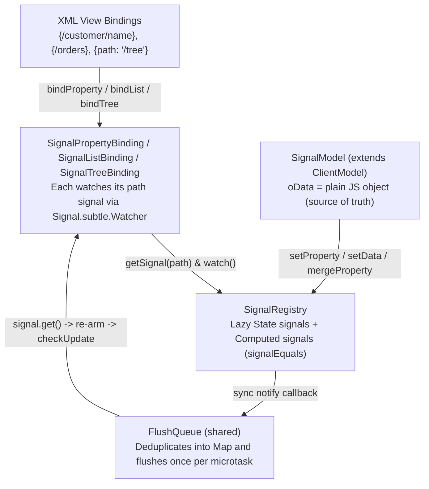
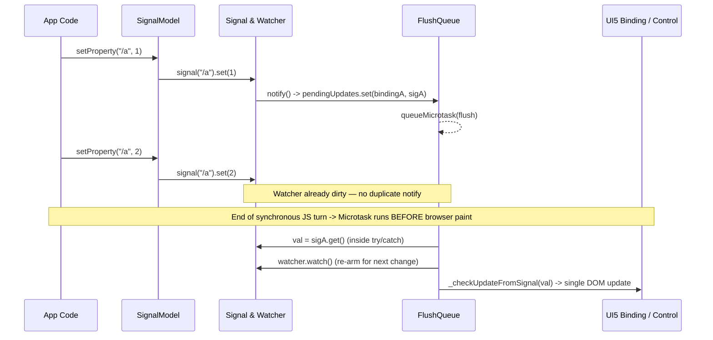
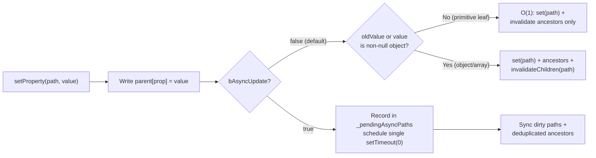
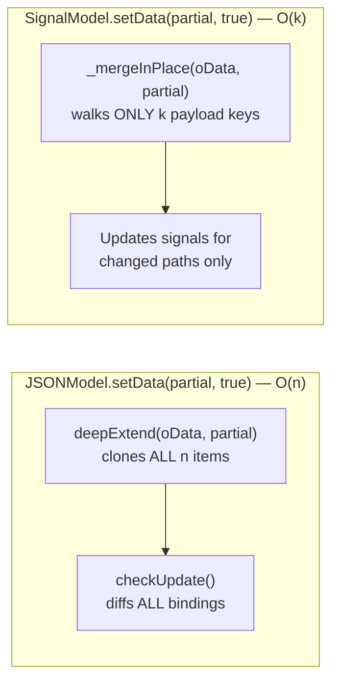
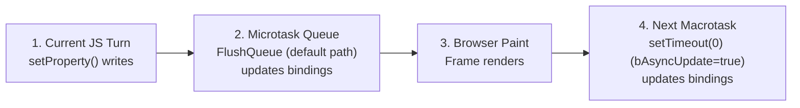

# Architecture

Implementation-level details of SignalModel's reactive architecture. For usage documentation, see the [library README](../packages/lib/README.md).

## Overview

## Unified Microtask Flush Queue

Each binding type (property, list, tree) subscribes to its path's signal via `Signal.subtle.Watcher`. When a signal changes, the Watcher callback fires synchronously, but `checkUpdate()` is not called immediately. All bindings share a single flush queue (`FlushQueue.ts`) that batches updates into one `queueMicrotask`:

- **One microtask per synchronous block**, regardless of how many bindings or binding types are notified.
- **Map-based deduplication**: `Map<binding, signal>` ensures each binding appears at most once. Rapid-fire `setProperty` calls (e.g., updating 10 fields in a loop) produce exactly one `checkUpdate` per affected binding.
- **Watcher re-arm and error isolation**: The TC39 Watcher fires at most once between `watch()` calls. The flush reads the current value (`signal.get()`, inside `try/catch` so a throwing computed cannot abort the batch), always re-arms the watcher (`watcher.watch()`), then updates the binding. For direct property bindings, the already-read value is passed straight to `_checkUpdateFromSignal`, avoiding a second path traversal.

When `bAsyncUpdate=true` is passed to `setProperty`, synchronous signal notification is skipped. Dirty paths are recorded in a `Map` and synced once in a single `setTimeout` pass with deduplicated ancestor invalidation. See [Batching and `bAsyncUpdate`](#batching-and-basyncupdate).

## O(1) Leaf Writes

In `setProperty`, `registry.invalidateChildren()` is only invoked when `oldValue` or `newValue` is a non-null object. For primitive-to-primitive leaf updates, no child signals can exist before or after the write, so scanning the signal registry is skipped completely. Combined with a zero-allocation `indexOf("/")` traversal in `_getObject` and a fast path for absolute paths, leaf `setProperty` runs in true O(1) time.

## In-Place Merge (Eliminating `deepExtend`)

UI5's `JSONModel.setData(data, true)` uses `sap/base/util/deepExtend` to deep-clone the entire model data and then overlay the merge payload. For a model with 1000 items where you merge 5, this clones all 1000, doing O(n) work for an O(k) operation.

SignalModel replaces this with an **in-place recursive merge** (`_mergeInPlace`) that:

1. Walks only the merge payload keys (not the entire data tree)
2. Compares old vs new values inline (`Object.is`)
3. Overwrites changed values directly in `this.oData`
4. Fires signals only for subtrees that actually changed, invalidating ancestors once at the merge root
5. Uses `structuredClone()` (with a `deepExtend` fallback for non-cloneable values like functions) for incoming object/array values to prevent external mutation

This reduces `setData(partial, true)` from O(n) to O(k) where k is the payload size. The improvement is largest for shallow merges into large datasets, common in form-based Fiori apps that update a few fields at a time.

## `structuredClone` with `deepExtend` Fallback

Where a pure deep clone is needed (not a merge), `structuredClone()` is used with a `try/catch` fallback to UI5's `deepExtend` when values contain non-cloneable properties (such as functions). This applies to `SignalListBinding.update()` for extended change detection and incoming objects in `_mergeInPlace()`.

## Batching and `bAsyncUpdate`

JSONModel's `setProperty` accepts a `bAsyncUpdate` flag that defers `checkUpdate` into a `setTimeout`, collapsing N synchronous `setProperty` calls into a single binding check pass. This is SAP's recommended workaround for the O(N²) problem documented in [openui5 issue 2600](https://github.com/UI5/openui5/issues/2600).

SignalModel supports this flag with targeted dirty-path tracking: when `bAsyncUpdate=true`, data is written immediately and the resolved path is recorded in `_pendingAsyncPaths`. A single `setTimeout` syncs only the dirty paths and their deduplicated ancestor signals (O(1) for sparse updates, O(N) for full-batch updates). Pending timers are cleared on `destroy()`. Without the flag (default), SignalModel uses its push-based microtask flush which provides O(1) per-path notification.

## Microtask vs Macrotask Scheduling

SignalModel has two scheduling paths depending on how `setProperty` is called:

- **Default (no `bAsyncUpdate`):** signal changes fire synchronously, and the FlushQueue batches binding updates via `queueMicrotask`. Microtasks run before the browser paints, so the first frame always shows correct data. One paint, always consistent.
- **`bAsyncUpdate=true`:** signal notifications are skipped entirely during the `setProperty` loop. A single `setTimeout` syncs all signals afterward. This uses the same macrotask scheduling as JSONModel's `bAsyncUpdate` -- the browser may render one stale frame before bindings update.

The browser event loop processes work in this order:

The default path gives SignalModel a visual consistency advantage over JSONModel's `bAsyncUpdate`: no stale frames. When `bAsyncUpdate=true` is explicitly requested, SignalModel matches JSONModel's `setTimeout`-based batching -- same scheduling, same visual behavior, same performance.
