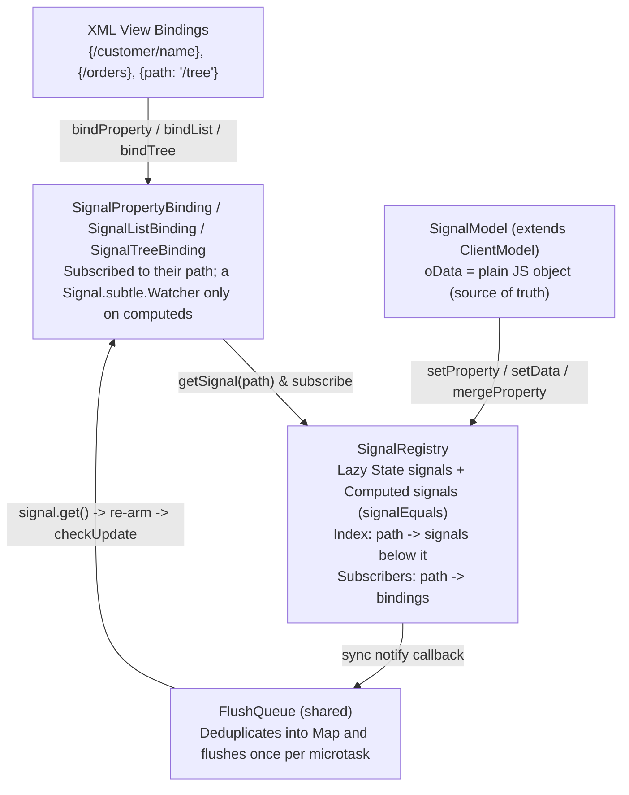
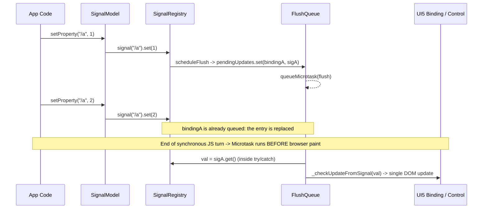
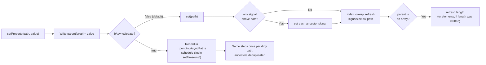
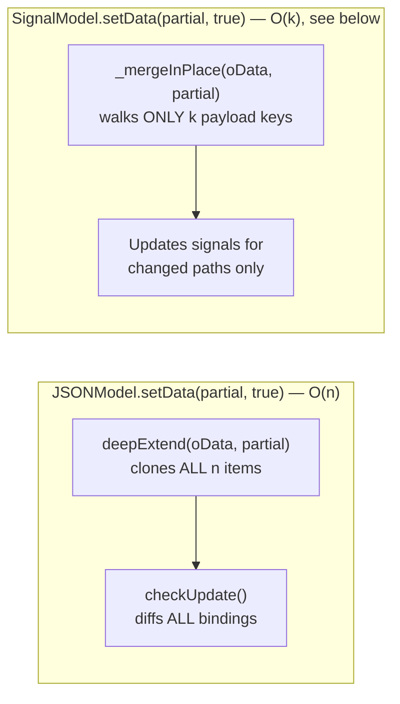
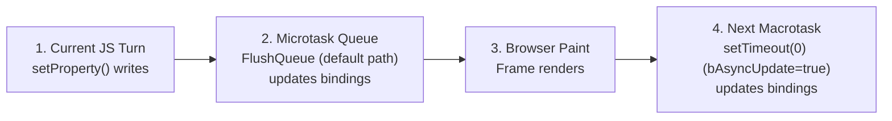

# Architecture

Implementation-level details of SignalModel's reactive architecture. For usage documentation, see the [library README](../packages/lib/README.md).

## Overview

## Unified Microtask Flush Queue

Each binding type (property, list, tree) subscribes to its path in the registry. The registry is the only writer of state signals, so when it sets one to a changed value it queues the bindings of that path itself. A binding on plain data therefore needs no `Signal.subtle.Watcher`; only a binding that resolves through a computed has one, because a computed changes through its dependencies. For the same reason `set()` on a state signal from `getSignal()` does not set the signal directly: it calls `setProperty` for the signal's path, so the data, the bindings and the computeds stay in line. Data changed without the model (`getData()` and then `refresh()`) is picked up as in JSONModel: the model first delivers the updates still queued, then reads every signal's value again without notifying and lets all bindings check; such a check compares the values as JSONModel does. The `observe` option (JSONModel's `bObserve`) uses the same path: the setters put on the data (as JSONModel's `observeData` does) call it. Either way `checkUpdate()` is not called immediately. All bindings share a single flush queue (`FlushQueue.ts`) that batches updates into one `queueMicrotask`:

- **One microtask per synchronous block**, regardless of how many bindings or binding types are notified.
- **Map-based deduplication**: `Map<binding, signal>` ensures each binding appears at most once. Rapid-fire `setProperty` calls (e.g., updating 10 fields in a loop) produce exactly one `checkUpdate` per affected binding.
- **Error isolation**: The flush reads the current value (`signal.get()`, inside `try/catch` so a throwing computed cannot abort the batch), then updates the binding. A binding on a computed has a watcher, which fires at most once between `watch()` calls, so the flush re-arms it first. For direct property bindings, the already-read value is passed straight to `_checkUpdateFromSignal`, avoiding a second path traversal.
- **Cancelled updates**: An update earlier in a batch can destroy a binding or move it to another path (a list re-using an item for a different row). `cancelFlush()` then removes the binding from the batch being processed as well, so the value of its old path is not applied to it.

When `bAsyncUpdate=true` is passed to `setProperty`, synchronous signal notification is skipped. Dirty paths are recorded in a `Set` and synced once in a single `setTimeout` pass with deduplicated ancestor invalidation. See [Batching and `bAsyncUpdate`](#batching-and-basyncupdate).

## Write Cost: Only the Signals a Write Can Affect

A write to a path can change three groups of signals: the path itself, its ancestors (`/a` when `/a/b` is written), and everything below it (`/a/b/c`). `setProperty` updates exactly these and never scans the registry.

- **The path itself:** one `Map` lookup.
- **Ancestors:** one lookup per path segment. The registry tracks the depth of its shallowest signal; when no signal can exist above the written path, the walk is skipped.
- **Signals below:** the registry keeps an index from each path to the state signals below it, filled when a signal is created. A write looks up its own path in that index and refreshes what it finds. Signals below a path exist even when the value is a primitive: a binding to `/name/length` shows the length of a string.
- **Arrays:** writing an element also refreshes the array's `length` signal, because a write past the end grows the array. Writing `length` refreshes the elements.

For a leaf with no signals below it, this is a constant number of lookups. Combined with a zero-allocation `indexOf("/")` traversal in `_getObject`, the cost of a write does not depend on how many bindings the model has.

Cost of the index: creating a signal adds one entry per ancestor path (about 0.2 µs per binding in a model-only measurement with 2000 bindings). Before the index existed, a write of an object or array value scanned every signal in the registry, which made "replace every row object" quadratic: 2000 row writes with 2000 bindings took about 75 ms and now take about 1.3 ms.

## Memory

Memory grows with the number of bound paths, not with the amount of data. The data is one plain object in both models, and SignalModel creates a signal only for a path that a binding or `getSignal` asks for. Measured in headless Chrome 158 with `npm run bench:memory` (heap after garbage collection, 20,000 property bindings each, 5,000 for the control):

| What                                                       | JSONModel | SignalModel |
| ---------------------------------------------------------- | --------- | ----------- |
| 20,000 rows of data (2.3 MB as JSON text), nothing bound   | 3.75 MB   | 3.75 MB     |
| One property binding on a top-level path (`/k1`)           | ~0.5 kB   | ~0.6 kB     |
| One property binding on `/items/1/name`                    | ~0.5 kB   | ~0.7 kB     |
| One property binding on an 8-segment path                  | ~0.5 kB   | ~0.8 kB     |
| A `sap.m.Text` property bound to `/items/1/name` (binding) | ~1.1 kB   | ~1.4 kB     |
| One list binding over 20,000 rows, per row                 | ~80 B     | ~80 B       |

So a property binding costs about 0.1-0.35 kB more than with JSONModel: the state signal, the subscription and the entries of the path index. The index is the part that grows with the path depth. As a range: 1,000 bound paths are about 0.7 MB instead of 0.5 MB, 10,000 about 7 MB instead of 5 MB. A binding that resolves through a computed also has a watcher, about 0.6 kB. A list binding costs the same in both models, and unbound data costs nothing extra, so 100,000 rows shown through a table with 20 visible rows need signals only for the cells of those rows. The numbers are from one machine and one Chrome version.

Up to version 0.1.2 every binding had its own watcher and a property binding cost about 1.5 kB.

## In-Place Merge (Eliminating `deepExtend`)

UI5's `JSONModel.setData(data, true)` uses `sap/base/util/deepExtend` to deep-clone the entire model data and then overlay the merge payload. For a model with 1000 items where you merge 5, this clones all 1000, doing O(n) work for an O(k) operation.

SignalModel replaces this with an **in-place recursive merge** (`_mergeInPlace`) that:

1. Walks only the merge payload keys (not the entire data tree)
2. Compares old vs new values inline (`Object.is`)
3. Overwrites changed values directly in `this.oData`
4. Fires signals only for subtrees that actually changed, invalidating ancestors once at the merge root
5. Clones incoming plain-object/array values with `deepExtend` to prevent external mutation

The result matches `JSONModel.setData(data, true)`: payload keys whose value is `undefined` are skipped, and the merge descends only into arrays and plain objects. A `Date` or class instance in the payload replaces the existing value; class instances keep their identity and prototype.

JSONModel's rebuild also leaves out every key that holds `undefined` and the trailing `undefined` entries of every array, anywhere in the data. `_dropUndefined` does that in place before the merge, with one pass over the data. The pass runs only when the data may hold such a value: after new data, a `refresh()`, or a `setProperty` with an object, `undefined` or `length`. One pass over 20,000 rows of three properties takes about 1 ms; a merge after writes of primitives or after another merge skips it.

This reduces `setData(partial, true)` from O(n) to O(k) where k is the payload size, for every merge that can skip that pass.

Data that cannot be changed in place is rebuilt with `deepExtend`, as JSONModel does with all data: a root that is a class instance or no object, and data in which the merge meets an object it cannot write to (frozen, for example). The in-place merge then throws a `TypeError`, the model rebuilds the data including the payload, and all signals read their value again. The improvement is largest for shallow merges into large datasets, common in form-based Fiori apps that update a few fields at a time.

## List Copies

`SignalListBinding.update()` copies the list with the same functions as `JSONListBinding`: `slice()` for arrays, `extend` for objects, and `deepExtend` for extended change detection. An earlier version used `structuredClone()`. It was faster for extended change detection (about 0.75 ms instead of 0.96 ms per update of 2,000 flat rows) but gave different results for keys holding `undefined` and for properties set on a `Map`, `Set` or `Date`.

A non-detecting copy shares its row objects with the model, in both models. A write to a row is therefore not a change for the list binding, and a sorted list does not sort again. JSONModel's merge is the exception: it rebuilds the data, so the binding's rows are no longer the model's rows and the binding notices the difference. SignalModel merges in place, so the model tells its list bindings about a merge (`SignalListBinding._onMerge`): a `setData` merge reaches every list binding, a `mergeProperty` that changed something reaches the bindings at or below the merged path, and the binding whose row is the merged path. If the merge changed a row of the list, the binding updates. Otherwise it takes its own copy of the rows, as JSONModel's binding is left with the rows from before the merge, and its comparison then sees the next change in a row, whether written through the model or found at a `refresh()`. The copy is made once and kept until the binding's next update, also over further merges. A suspended binding is compared only at `resume()`, so it takes that copy before the first merge that changes one of its rows; a change that a later merge takes back is then no change, as in JSONModel. Extended change detection compares the data or the key of each row. Only where the key is the row object itself does JSONModel's merge make a difference, and there it counts only for the update that directly follows it. The cost is one loop over the list bindings per merge, plus that copy of the rows for a list binding without change detection that still shares them; property bindings are not involved. Measured without controls on a model with one such list binding over 20,000 rows: the first merge elsewhere in the data takes 6.9 ms (the copy), further ones are below the timer's resolution, and a merge that changes a row takes 0.01 ms. JSONModel takes 7-8 ms for each of the three.

## Batching and `bAsyncUpdate`

JSONModel's `setProperty` accepts a `bAsyncUpdate` flag that defers `checkUpdate` into a `setTimeout`, collapsing N synchronous `setProperty` calls into a single binding check pass. This is SAP's recommended workaround for the O(N²) problem documented in [openui5 issue 2600](https://github.com/UI5/openui5/issues/2600).

SignalModel supports this flag with targeted dirty-path tracking: when `bAsyncUpdate=true`, data is written immediately and the resolved path is recorded in `_pendingAsyncPaths`. A single `setTimeout` syncs only the dirty paths, the signals below them and their deduplicated ancestor signals (O(1) for sparse updates, O(N) for full-batch updates). Pending timers are cleared on `destroy()`. Without the flag (default), SignalModel uses its push-based microtask flush which provides O(1) per-path notification.

## Microtask vs Macrotask Scheduling

SignalModel has two scheduling paths depending on how `setProperty` is called:

- **Default (no `bAsyncUpdate`):** signal changes fire synchronously, and the FlushQueue batches binding updates via `queueMicrotask`. Microtasks run before the browser paints, so the first frame always shows correct data. One paint, always consistent.
- **`bAsyncUpdate=true`:** signal notifications are skipped entirely during the `setProperty` loop. A single `setTimeout` syncs the signals of the written paths afterward (see above). This uses the same macrotask scheduling as JSONModel's `bAsyncUpdate` -- the browser may render one stale frame before bindings update.

The browser event loop processes work in this order:

The default path gives SignalModel a visual consistency advantage over JSONModel's `bAsyncUpdate`: no stale frames. When `bAsyncUpdate=true` is explicitly requested, SignalModel matches JSONModel's `setTimeout`-based batching -- same scheduling, same visual behavior, same performance.
