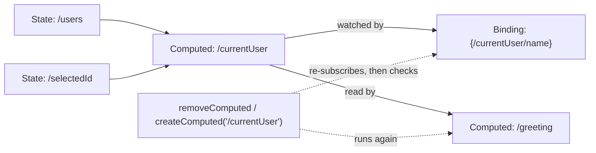

# ui5-lib-signal-model

A reactive, signal-based UI5 model that replaces JSONModel as a drop-in. Uses the [TC39 Signals proposal](https://github.com/tc39/proposal-signals) polyfill internally, replacing poll-based `checkUpdate()` with push-based, path-specific signal notifications.

> [!CAUTION]
> This is an **experimental proof of concept** exploring reactive primitives in the UI5 ecosystem. Treat it as a technical exploration and learning exercise, not a production-ready library.
>
> A minor version may be published to npm so that others can try it out and experiment. This does **not** indicate production readiness. The API surface may change without notice between releases.

## Install

```bash
npm install ui5-lib-signal-model
```

> [!NOTE]
> The npm package ships both `dist/` and `src/` -- see [Serving the library](#serving-the-library) for why and when each is used.

### TypeScript

Add the library to `compilerOptions.types` so TypeScript can resolve the type declarations. If your app does not already depend on UI5 typings, install them too (`@sapui5/types` works as well):

```bash
npm install -D @openui5/types
```

```json
{
  "compilerOptions": {
    "types": ["@openui5/types", "ui5-lib-signal-model"]
  }
}
```

### Serving the library

The npm package ships both pre-built distributables (`dist/`) and TypeScript sources (`src/`). There are three ways to serve the library in your app:

#### Option A: Pre-built (recommended)

The package includes a [UI5 build manifest](https://github.com/SAP/ui5-tooling/blob/main/rfcs/0006-local-dependency-resolution.md) (`dist/.ui5/build-manifest.json`). UI5 Tooling v4+ detects it automatically and serves the pre-built JavaScript from `dist/` with no extra configuration:

```bash
npm install ui5-lib-signal-model
# That's it. `ui5 serve` picks up the build manifest.
```

No transpile tooling, no middleware, no additional `ui5.yaml` changes.

#### Option B: Transpile from source

If you prefer to serve from TypeScript sources (e.g. for debugging with source maps), install [`ui5-tooling-transpile`](https://github.com/ui5-community/ui5-ecosystem-showcase/tree/main/packages/ui5-tooling-transpile) and enable `transpileDependencies` in your app's `ui5.yaml`:

```bash
npm install -D ui5-tooling-transpile
```

```yaml
# ui5.yaml
server:
  customMiddleware:
    - name: ui5-tooling-transpile-middleware
      afterMiddleware: compression
      configuration:
        transpileDependencies: true
```

This transpiles the library's `.ts` sources on the fly during `ui5 serve`.

#### Option C: Static serving (workaround)

If neither option works for your setup, you can mount the pre-built resources manually using [`ui5-middleware-servestatic`](https://github.com/ui5-community/ui5-ecosystem-showcase/tree/main/packages/ui5-middleware-servestatic) (or a similar community middleware) and point it at the `dist/resources` folder in `node_modules`:

```bash
npm install -D ui5-middleware-servestatic
```

```yaml
# ui5.yaml
server:
  customMiddleware:
    - name: ui5-middleware-servestatic
      afterMiddleware: compression
      configuration:
        rootPath: node_modules/ui5-lib-signal-model/dist/resources
```

## Setup

Add the library dependency to your `manifest.json`:

```json
{
  "sap.ui5": {
    "dependencies": {
      "libs": {
        "ui5.model.signal": {}
      }
    }
  }
}
```

### UI5 Version Compatibility

- **Minimum supported version:** OpenUI5 / SAPUI5 **`1.143.0+`** (developed and verified against `1.154.0`).
- **OpenUI5 / SAPUI5 `1.120 LTS` – `1.142`:** `SignalModel`, `SignalPropertyBinding`, `SignalListBinding`, `Lib.init({ apiVersion: 2 })`, and `Messaging` all work on `1.120+`. The **only** API requiring `1.143.0+` is `ClientTreeBinding.prototype.cloneData` (and `oTreeData` snapshotting in `ClientTreeBinding`'s constructor), which `SignalTreeBinding` delegates to directly without shipping a fallback shim. If you need to target `1.120 LTS` and use `bindTree()`, you can either avoid `SignalTreeBinding` or add a small `cloneData` (`structuredClone` + fallback symbol) and `oTreeData` snapshot shim in a subclass/fork.

## Usage

```typescript
import SignalModel from "ui5/model/signal/SignalModel";

// Drop-in replacement for JSONModel
const model = new SignalModel({
  customer: { name: "Alice", age: 28 },
  orders: [],
});

// Works with standard XML view bindings
// {/customer/name}, {/orders}, etc.
```

### Typed Model

```typescript
interface AppData {
  customer: { name: string; age: number };
  orders: Array<{ id: number; total: number }>;
}

const model = new SignalModel<AppData>({
  customer: { name: "Alice", age: 28 },
  orders: [],
});

model.getProperty("/customer/name"); // string (typed)
model.setProperty("/customer/age", 31); // type-checked
model.setProperty("/customer/age", "x"); // compile error
```

Path types follow the same conventions as UI5's typed model patterns from `@openui5/types`.

### Declarative Binding

SignalModel works with standard UI5 declarative bindings in XML views, one-way and two-way:

```xml
<!-- Property binding -->
<Input value="{/customer/name}" />
<Text text="{/customer/name}" />

<!-- List binding -->
<List items="{/orders}">
  <StandardListItem title="{id}" description="{total}" />
</List>

<!-- Tree binding -->
<Tree items="{path: '/org', parameters: {arrayNames: ['children']}}">
  <StandardTreeItem title="{name}" />
</Tree>

<!-- Named model -->
<Text text="{signals>/customer/name}" />

<!-- Expression binding -->
<Text text="{= ${/customer/name} + ' (' + ${/customer/age} + ')'}" />
```

## Computed Signals

Derived values that update automatically when dependencies change:

```typescript
model.createComputed("/fullName", ["/firstName", "/lastName"], (first, last) => `${first} ${last}`);

// Bind to it like any other path
// <Text text="{/fullName}" />
```

### Computed Signal Immutability

Computed signals are **define-once**: `createComputed` throws a `TypeError` on a path that already holds a computed, and on a path that was already read as plain data through a binding or `getSignal` on exactly that path. A binding on a path below it (`/user/name` before `createComputed("/user", …)`) is fine and follows the computed. To redefine a computed, call `removeComputed` first; a path that had a computed can get a new one at any time, also while bindings are on it.

```typescript
model.createComputed("/total", ["/price", "/tax"], (p, t) => p * (1 + t));

// Throws -- computed already exists at /total:
model.createComputed("/total", ["/price"], (p) => p);

// Correct -- remove first, then redefine:
model.removeComputed("/total");
model.createComputed("/total", ["/price"], (p) => p);
```

> **Why define-once?** Both the [TC39 Signals proposal](https://github.com/tc39/proposal-signals) and [MobX 6](https://mobx.js.org/computeds.html) treat computed values as immutable. A `Signal.Computed`'s derivation function is fixed at construction. MobX 6 enforces "every field can be annotated only once" and provides no public API to replace a `ComputedValue`'s derivation. UI5 formatters, the closest existing equivalent, are also fixed in code and never replaced at runtime.
>
> **Declarative binding bridge.** UI5 bindings declared in XML views are managed by the framework. While developers _can_ access bindings programmatically (`getBinding`, `unbindProperty`, etc.), the common pattern in Fiori/UI5 applications is declarative -- bindings are declared in XML and the developer never touches them directly. Bindings therefore move to a redefined computed by themselves (see [below](#creating-removing-and-redefining-while-bound)), regardless of how they were created.

### Computed Signals That Throw

An error thrown by a computed's function is not turned into a value:

- `getProperty`, `getObject` and a new binding on the path rethrow the error until a dependency changes and the function succeeds again. This is how `Signal.Computed` behaves, and how JSONModel behaves when a formatter throws.
- A binding that already shows a value keeps it. The error is logged, and other bindings update as usual.
- `createComputed` runs the function once. If that first run throws, `createComputed` throws and no computed is registered, so the function must handle the data the model holds at that moment (for example before `loadData` has finished).

### Creating, Removing and Redefining While Bound

A `Signal.Computed` has a fixed function, so changing what a path derives means another signal object at that path. Whatever used the old one has to move to the new one. The model does that whenever `createComputed` or `removeComputed` is called:

| What exists                                             | After `createComputed(path)`                             | After `removeComputed(path)`        |
| ------------------------------------------------------- | -------------------------------------------------------- | ----------------------------------- |
| Bindings on the path or below it (property, list, tree) | follow the computed, also if they were created before it | follow the model's data at the path |
| Computeds that depend on the path or on a path below it | run again with the computed's value                      | run again with the model's data     |

The bindings re-subscribe at once and check their value in the next microtask, so a control shows the new value without a write to one of the inputs.



```typescript
// XML view has: <Text text="{/total}" />

model.removeComputed("/total");
model.createComputed("/total", ["/newPrice", "/newTax"], (p, t) => p * (1 + t));
// The text shows the new formula's value and follows /newPrice and /newTax.

model.removeComputed("/total");
// The text shows the model's data at /total (undefined if there is none) and follows writes to it.
```

A dependency can be the path of plain data, of a computed, or a path inside a computed's value:

```typescript
model.createComputed("/currentUser", ["/users", "/selectedId"], (users, id) => users[id]);
model.createComputed("/greeting", ["/currentUser/name"], (name) => `Hello ${name}`);
// /greeting follows /currentUser, also after /currentUser is redefined or removed.
```

One limit: **a binding on exactly the path before the first `createComputed`** makes that call throw (define-once, see above). Create the computed before the view binds to it, for example in `onInit` or in the component.

**Cost.** Per `createComputed` or `removeComputed`, one pass over the paths that have bindings and over the state signals below the path. A computed that no other computed depends on costs nothing extra; one that others depend on (itself or a path inside it) gets one small signal that tells them when it was replaced.

### Computed Sub-Path Traversal

When a computed signal returns an object or array, you can bind to paths **inside** that return value. The model traverses into the computed value automatically:

```typescript
model.createComputed("/currentUser", ["/users", "/selectedId"], (users, id) => users[id]);

// Bind to sub-paths -- these read through the computed's return value
// <Text text="{/currentUser/name}" />
// <Text text="{/currentUser/email}" />

// List binding on a computed array works too
model.createComputed("/activeItems", ["/items"], (items) => items.filter((i) => i.active));
// <List items="{/activeItems}"> <StandardListItem title="{name}" /> </List>
```

In a path like `/currentUser/name`, the model resolves `/currentUser` as a computed signal, calls its derivation function, then navigates `.name` within the returned object. Only **one** computed "pivot" can exist per path -- everything below it is plain object traversal.

**Computed paths are read-only.** `setProperty`, `mergeProperty`, and two-way bindings on computed paths (or their sub-paths) return `false` and log a warning. This matches the industry consensus: [Vue](https://vuejs.org/guide/essentials/computed.html), [MobX](https://mobx.js.org/computeds.html), [SolidJS](https://docs.solidjs.com/reference/basic-reactivity/create-memo), and [Angular Signals](https://angular.dev/guide/signals) all treat computeds as read-only.

```typescript
model.setProperty("/currentUser/name", "Bob"); // returns false -- computed path is read-only
```

To update the data, write to the **source** path. The computed re-derives automatically and all sub-path bindings update:

```typescript
model.setProperty("/users/0/name", "Bob"); // writes to source data -- /currentUser/name updates
```

### Computed Re-Evaluation and Sub-Path Notifications

When a computed re-evaluates, all bindings that resolve through it are notified, including bindings on its sub-paths. Each compares its old value to the new one and updates only if it differs. A computed is one unit: it is re-evaluated as a whole when a dependency changes, so keep the dependencies as narrow as the value needs.

Why that is, what it costs and how to split a computed: [Computed Signals: Re-Evaluation and Notifications](https://github.com/wridgeu/ui5-lib-signal-model/blob/main/docs/computed-signals.md).

## Configuration Modes

SignalModel defaults to **full JSONModel parity**: `setProperty` returns `false` for nonexistent parent paths, exactly like JSONModel. Three options independently extend this behavior, each controlling a different level of the path:

```
model.setProperty("/a/b/c", value)
                   ↑   ↑
                   │   └── LEAF: "c" on parent {b}     ← strictLeafCheck controls this
                   └────── INTERMEDIATE: {a}, {b}       ← autoCreatePaths controls this
```

- **`autoCreatePaths: true`**: Auto-creates intermediate objects when setting a deeply nested path. `model.setProperty("/a/b/c", value)` creates `{a: {b: {}}}` if the parent path doesn't exist, instead of returning `false`. Useful for dynamic form models where the schema isn't known upfront. Only missing parents (`undefined` or `null`) are created. An existing value is never replaced: with `name: ""`, `setProperty("/name/first", "x")` still returns `false`, and with `name: "Al"` it throws a `TypeError`, as in JSONModel.
- **`observe: true`** (or `true` as the second constructor argument, like JSONModel's `bObserve`): an assignment to a property of the data object (`model.getData().name = "x"`) updates the bindings without `refresh()`. As in JSONModel, the properties of the data are replaced by getters and setters and every such assignment checks all bindings, so writes get slower. Off by default.
- **`strictLeafCheck: true`**: Rejects `setProperty` writes to leaf properties that don't exist on the parent object (returns `false`). JSONModel allows creating new properties on existing parents; this flag prevents it. Useful for catching typos in property names against a known schema. A key that holds `undefined` is gone after a merge (as in JSONModel), so declare the properties of such a schema with `null`.

| `autoCreatePaths` | `strictLeafCheck` | Missing parent | New leaf on existing parent | Use case                         |
| ----------------- | ----------------- | -------------- | --------------------------- | -------------------------------- |
| `false` (default) | `false` (default) | `false`        | creates it                  | JSONModel parity                 |
| `true`            | `false`           | creates it     | creates it                  | Dynamic forms                    |
| `false`           | `true`            | `false`        | `false`                     | Typed schemas                    |
| `true`            | `true`            | creates it     | `false`                     | Scaffold structure, guard leaves |

All other APIs (`setData`, `getData`, `getProperty`, `bindProperty`, `bindList`, `bindTree`) behave identically regardless of configuration.

### Known Differences from JSONModel

The same operations run against both models in a randomized test, and UI5's own tests of the JSON model run against SignalModel. Four differences remain on purpose:

- **A merge works on the data in place.** The data after `setData(data, true)` or `mergeProperty` equals JSONModel's, but the existing objects are changed instead of rebuilt: `getData()` stays the same object. Data you changed directly needs `refresh()` before a merge drops its `undefined` keys.
- **Bindings update in a microtask**, not inside `setProperty`. A control shows the new value one microtask later, and an error in a formatter is logged instead of thrown out of `setProperty`.
- **A binding on an object or array fires for every write below it.** A formatter that reads from the object always shows current content; JSONModel can keep the old text.
- **A list binding keyed by the row object** does not fire after a merge that changed nothing. JSONModel's does, because its merge replaces every row object.

Details, the reason for each and what to do about it: [Differences from JSONModel](https://github.com/wridgeu/ui5-lib-signal-model/blob/main/docs/jsonmodel-differences.md).

### Merge Writes

`mergeProperty` performs a **recursive merge** at a specific path. It updates only the properties you provide and leaves the rest untouched. Compare with `setProperty`, which **replaces** the entire value:

```typescript
// Given: /customer = { name: "Alice", age: 28, city: "Berlin" }

// setProperty REPLACES the entire object -- name and city are gone:
model.setProperty("/customer", { age: 30 });
// Result: /customer = { age: 30 }

// mergeProperty MERGES into the existing object -- name and city survive:
model.mergeProperty("/customer", { age: 30 });
// Result: /customer = { name: "Alice", age: 30, city: "Berlin" }
```

`mergeProperty` only fires signals for paths that actually changed (here, only `/customer/age`). Bindings to `/customer/name` and `/customer/city` are not notified. The exception is data that cannot be written to, like a frozen object: the data is then rebuilt and every binding checks.

`setData(partial, true)` uses the same merge logic starting at the root. `mergeProperty("/", partial)` delegates to `setData(partial, true)` internally. Like that merge, `mergeProperty` merges only two arrays or two plain objects. Any other combination (a `Date`, a class instance, an array into an object) replaces the value, as `setProperty` does.

A sorted, filtered or grouped list sorts and filters again after a merge that changed one of its rows, as it does with JSONModel. A plain `setProperty` on a row does not make it sort again, in either model; call `refresh()` on the list binding for that.

## API

### Constructor

```typescript
// Data constructor (most common)
new SignalModel<T>(data?: T, options?: { autoCreatePaths?: boolean; strictLeafCheck?: boolean; observe?: boolean } | boolean)

// URL constructor -- loads JSON from a URL (calls loadData internally)
new SignalModel(url: string, options?: { autoCreatePaths?: boolean; strictLeafCheck?: boolean; observe?: boolean } | boolean)
```

### JSONModel-Compatible Methods

```typescript
model.setProperty("/path", value);        // returns boolean (true if successful)
model.getProperty("/path");
model.setData(data);                       // replace all data
model.setData(partial, true);              // merge into existing data
model.getData();
model.isList("/path");                     // true if value at path is an array
model.bindProperty("/path");
model.bindList("/path");
model.bindTree("/path", context, filters, { arrayNames: ["children"] }, sorters);

// Load JSON from a URL (fires requestSent/requestCompleted/requestFailed events).
// Like JSONModel, the returned promise rejects with { message, statusCode, statusText,
// responseText } when the request fails.
model.loadData(url, params?, async?, method?, merge?, cache?, headers?, abortSignal?);

// Promise that resolves when all pending loadData calls complete
await model.dataLoaded();

// Serialize / parse JSON
model.getJSON();                       // returns JSON string
model.setJSON(json);                   // parse and set
model.setJSON(json, true);             // parse and merge

// Cache control
model.forceNoCache(true);              // append cache-buster to loadData URLs
```

### Extended Methods

```typescript
// Merge writes (only fire changed paths)
model.mergeProperty("/customer", { age: 30 });

// Computed signals
model.createComputed("/fullName", ["/firstName", "/lastName"], (first, last) => `${first} ${last}`);
model.removeComputed("/fullName");

// Direct signal access
const signal = model.getSignal("/path");
signal.get(); // read current value
signal.set(1); // on a state signal: the same as model.setProperty("/path", 1); a refused write is logged

// Lifecycle
model.destroy(); // aborts in-flight requests, clears all subscriptions
```

### Binding Classes

| Class                   | Extends                 | Purpose                                              |
| ----------------------- | ----------------------- | ---------------------------------------------------- |
| `SignalPropertyBinding` | `ClientPropertyBinding` | Single-value bindings, updated by push               |
| `SignalListBinding`     | `ClientListBinding`     | List bindings with filter/sort, updated by push      |
| `SignalTreeBinding`     | `ClientTreeBinding`     | Tree bindings with hierarchy traversal, push updates |

## Feature Comparison: SignalModel vs JSONModel

| Feature                        | JSONModel                                                         | SignalModel                                                                                            |
| ------------------------------ | ----------------------------------------------------------------- | ------------------------------------------------------------------------------------------------------ |
| **Update mechanism**           | Poll-based: `checkUpdate()` iterates all bindings on every change | Push-based: only bindings to changed paths are notified via signals                                    |
| **Notification granularity**   | O(_n_) per `setProperty` call                                     | O(_k_) per `setProperty` call                                                                          |
| **Change detection**           | `deepEqual` comparison on every binding                           | Signal-based: `Object.is` for primitives, always-fire for objects; extended change detection for lists |
| **Property binding**           | `{/path}` in XML views                                            | Identical                                                                                              |
| **List binding**               | Filter + Sort via FilterProcessor/SorterProcessor                 | Same (reuses ClientListBinding internals)                                                              |
| **Tree binding**               | JSONTreeBinding with arrayNames                                   | SignalTreeBinding with same arrayNames support                                                         |
| **Expression binding**         | Supported                                                         | Supported (benefits from push-based dependency notification)                                           |
| **Two-way binding**            | Supported                                                         | Supported (identical behavior)                                                                         |
| **Declarative XML binding**    | Supported                                                         | Supported (full lifecycle: one-way, two-way, list, tree)                                               |
| **Named models**               | `{modelName>/path}`                                               | Identical                                                                                              |
| **Binding modes**              | OneWay, TwoWay, OneTime                                           | Same (inherits from ClientModel)                                                                       |
| **Nested bindings**            | Relative paths with context                                       | Same (relative and absolute)                                                                           |
| **setProperty / getProperty**  | Standard API                                                      | Same signatures, typed overloads with generics                                                         |
| **setData (replace)**          | Replaces data, notifies all bindings                              | Replaces data, fires all signals                                                                       |
| **setData (merge)**            | Merges data, notifies all bindings                                | Merges data, fires only changed signals                                                                |
| **mergeProperty**              | Not available                                                     | Surgical merge at any path, fires only changed signals                                                 |
| **Computed/derived values**    | Not available (use formatters)                                    | `createComputed("/path", deps, fn)` for model-layer derived state                                      |
| **Programmatic signal access** | Not available                                                     | `getSignal("/path")` returns underlying `Signal.State` or `Signal.Computed`                            |
| **Path auto-creation**         | Returns `false` for nonexistent parent paths                      | Same by default; `{ autoCreatePaths: true }` creates intermediates automatically                       |
| **Leaf property guard**        | Not available                                                     | `{ strictLeafCheck: true }` rejects writes to nonexistent leaf properties                              |
| **TypeScript generics**        | Via TypedJSONModel wrapper                                        | Built-in: `new SignalModel<T>(data)` with path autocompletion                                          |
| **TC39 Signals alignment**     | N/A                                                               | Uses signal-polyfill; swap for native Signal when spec ships                                           |

> **Algorithmic complexity legend:**
>
> - **_n_** = total number of bindings registered on the model (all paths combined)
> - **_k_** = number of bindings affected by a single change: the changed path itself, plus its parent paths (e.g. `/customer` when changing `/customer/name`), plus its child paths (e.g. `/customer/name` and `/customer/age` when replacing the `/customer` object)
>
> JSONModel's `checkUpdate()` iterates **all** _n_ bindings on every write, even if only one path changed. SignalModel notifies only the _k_ bindings whose paths are affected. When _k_ ≪ _n_ (typical in large models), SignalModel avoids O(_n_) work per change.

### TypeScript Generics

SignalModel's typed path system builds on the patterns from UI5's `TypedJSONModel` wrapper in `@openui5/types`. The `ModelPath<T>` and `PathValue<T, P>` utility types follow the same conventions for extracting absolute binding paths and resolving value types. `TypedJSONModel` requires a separate wrapper class; SignalModel has generics built in, so `new SignalModel<T>(data)` gives typed `getProperty` and `setProperty` with path autocompletion directly.

## License

MIT
