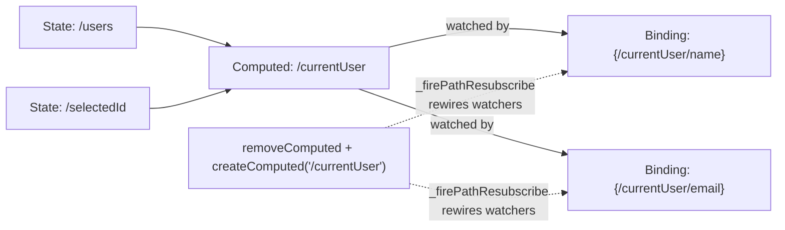

# ui5-lib-signal-model

A reactive, signal-based UI5 model that replaces JSONModel as a drop-in. Uses the [TC39 Signals proposal](https://github.com/tc39/proposal-signals) polyfill internally, replacing poll-based `checkUpdate()` with push-based, path-specific signal notifications.

> [!CAUTION]
> This is an **experimental proof of concept** exploring reactive primitives in the UI5 ecosystem. Treat it as a technical exploration and learning exercise, not a production-ready library.
>
> A minor version may be published to npm so that others can try it out and experiment. This does **not** indicate production readiness. The API surface may change without notice between releases.

## Install

```bash
npm install ui5-lib-signal-model
```

> [!NOTE]
> The npm package ships both `dist/` and `src/` -- see [Serving the library](#serving-the-library) for why and when each is used.

### TypeScript

Add the library to `compilerOptions.types` so TypeScript can resolve the type declarations. If your app does not already depend on UI5 typings, install them too (`@sapui5/types` works as well):

```bash
npm install -D @openui5/types
```

```json
{
  "compilerOptions": {
    "types": ["@openui5/types", "ui5-lib-signal-model"]
  }
}
```

### Serving the library

The npm package ships both pre-built distributables (`dist/`) and TypeScript sources (`src/`). There are three ways to serve the library in your app:

#### Option A: Pre-built (recommended)

The package includes a [UI5 build manifest](https://github.com/SAP/ui5-tooling/blob/main/rfcs/0006-local-dependency-resolution.md) (`dist/.ui5/build-manifest.json`). UI5 Tooling v4+ detects it automatically and serves the pre-built JavaScript from `dist/` with no extra configuration:

```bash
npm install ui5-lib-signal-model
# That's it. `ui5 serve` picks up the build manifest.
```

No transpile tooling, no middleware, no additional `ui5.yaml` changes.

#### Option B: Transpile from source

If you prefer to serve from TypeScript sources (e.g. for debugging with source maps), install [`ui5-tooling-transpile`](https://github.com/ui5-community/ui5-ecosystem-showcase/tree/main/packages/ui5-tooling-transpile) and enable `transpileDependencies` in your app's `ui5.yaml`:

```bash
npm install -D ui5-tooling-transpile
```

```yaml
# ui5.yaml
server:
  customMiddleware:
    - name: ui5-tooling-transpile-middleware
      afterMiddleware: compression
      configuration:
        transpileDependencies: true
```

This transpiles the library's `.ts` sources on the fly during `ui5 serve`.

#### Option C: Static serving (workaround)

If neither option works for your setup, you can mount the pre-built resources manually using [`ui5-middleware-servestatic`](https://github.com/ui5-community/ui5-ecosystem-showcase/tree/main/packages/ui5-middleware-servestatic) (or a similar community middleware) and point it at the `dist/resources` folder in `node_modules`:

```bash
npm install -D ui5-middleware-servestatic
```

```yaml
# ui5.yaml
server:
  customMiddleware:
    - name: ui5-middleware-servestatic
      afterMiddleware: compression
      configuration:
        rootPath: node_modules/ui5-lib-signal-model/dist/resources
```

## Setup

Add the library dependency to your `manifest.json`:

```json
{
  "sap.ui5": {
    "dependencies": {
      "libs": {
        "ui5.model.signal": {}
      }
    }
  }
}
```

### UI5 Version Compatibility

- **Minimum supported version:** OpenUI5 / SAPUI5 **`1.143.0+`** (developed and verified against `1.154.0`).
- **OpenUI5 / SAPUI5 `1.120 LTS` – `1.142`:** `SignalModel`, `SignalPropertyBinding`, `SignalListBinding`, `Lib.init({ apiVersion: 2 })`, and `Messaging` all work on `1.120+`. The **only** API requiring `1.143.0+` is `ClientTreeBinding.prototype.cloneData` (and `oTreeData` snapshotting in `ClientTreeBinding`'s constructor), which `SignalTreeBinding` delegates to directly without shipping a fallback shim. If you need to target `1.120 LTS` and use `bindTree()`, you can either avoid `SignalTreeBinding` or add a small `cloneData` (`structuredClone` + fallback symbol) and `oTreeData` snapshot shim in a subclass/fork.

## Usage

```typescript
import SignalModel from "ui5/model/signal/SignalModel";

// Drop-in replacement for JSONModel
const model = new SignalModel({
  customer: { name: "Alice", age: 28 },
  orders: [],
});

// Works with standard XML view bindings
// {/customer/name}, {/orders}, etc.
```

### Typed Model

```typescript
interface AppData {
  customer: { name: string; age: number };
  orders: Array<{ id: number; total: number }>;
}

const model = new SignalModel<AppData>({
  customer: { name: "Alice", age: 28 },
  orders: [],
});

model.getProperty("/customer/name"); // string (typed)
model.setProperty("/customer/age", 31); // type-checked
model.setProperty("/customer/age", "x"); // compile error
```

Path types follow the same conventions as UI5's typed model patterns from `@openui5/types`.

### Declarative Binding

SignalModel works with standard UI5 declarative bindings in XML views, one-way and two-way:

```xml
<!-- Property binding -->
<Input value="{/customer/name}" />
<Text text="{/customer/name}" />

<!-- List binding -->
<List items="{/orders}">
  <StandardListItem title="{id}" description="{total}" />
</List>

<!-- Tree binding -->
<Tree items="{path: '/org', parameters: {arrayNames: ['children']}}">
  <StandardTreeItem title="{name}" />
</Tree>

<!-- Named model -->
<Text text="{signals>/customer/name}" />

<!-- Expression binding -->
<Text text="{= ${/customer/name} + ' (' + ${/customer/age} + ')'}" />
```

## Computed Signals

Derived values that update automatically when dependencies change:

```typescript
model.createComputed("/fullName", ["/firstName", "/lastName"], (first, last) => `${first} ${last}`);

// Bind to it like any other path
// <Text text="{/fullName}" />
```

### Computed Signal Immutability

Computed signals are **define-once**: calling `createComputed` on a path that already holds a computed or a state signal (i.e., a path already accessed through a binding or `getSignal`) throws a `TypeError`. To redefine an existing computed, call `removeComputed` first.

```typescript
model.createComputed("/total", ["/price", "/tax"], (p, t) => p * (1 + t));

// Throws -- computed already exists at /total:
model.createComputed("/total", ["/price"], (p) => p);

// Correct -- remove first, then redefine:
model.removeComputed("/total");
model.createComputed("/total", ["/price"], (p) => p);
```

> **Why define-once?** Both the [TC39 Signals proposal](https://github.com/tc39/proposal-signals) and [MobX 6](https://mobx.js.org/computeds.html) treat computed values as immutable. A `Signal.Computed`'s derivation function is fixed at construction. MobX 6 enforces "every field can be annotated only once" and provides no public API to replace a `ComputedValue`'s derivation. UI5 formatters, the closest existing equivalent, are also fixed in code and never replaced at runtime.
>
> **Declarative binding bridge.** UI5 bindings declared in XML views are managed by the framework. While developers _can_ access bindings programmatically (`getBinding`, `unbindProperty`, etc.), the common pattern in Fiori/UI5 applications is declarative -- bindings are declared in XML and the developer never touches them directly. SignalModel's automatic resubscription mechanism (described below) ensures that `removeComputed` + `createComputed` works seamlessly regardless of how bindings were created.

### Computed Signals That Throw

An error thrown by a computed's function is not turned into a value:

- `getProperty`, `getObject` and a new binding on the path rethrow the error until a dependency changes and the function succeeds again. This is how `Signal.Computed` behaves, and how JSONModel behaves when a formatter throws.
- A binding that already shows a value keeps it. The error is logged, and other bindings update as usual.
- `createComputed` runs the function once. If that first run throws, `createComputed` throws and no computed is registered, so the function must handle the data the model holds at that moment (for example before `loadData` has finished).

### Automatic Resubscription

When a `Signal.Computed` is created, its derivation function is fixed. To change what a computed derives, you must replace it with `removeComputed` + `createComputed`. But the bindings watching that path still hold a watcher on the **old** signal object -- they would never see updates from the new one.

SignalModel solves this with **automatic resubscription**. When `createComputed` is called, the model notifies every existing binding to that path (and to any sub-path below it). Each notified binding tears down its watcher on the old signal and subscribes to the new one -- transparently, in a single synchronous step.



This means you can redefine a computed at any time and all bindings will see the new derivation, even if it has entirely different dependencies:

```typescript
// XML view has: <Text text="{/total}" />

model.removeComputed("/total");
model.createComputed("/total", ["/newPrice", "/newTax"], (p, t) => p * (1 + t));
// All bindings to /total now track the new formula. No binding manipulation needed.
```

**Sub-path resubscription.** When a computed returns an object and bindings target sub-paths (e.g., `{/currentUser/name}`), those sub-path bindings also resubscribe automatically when the parent computed is redefined. The model scans for all bindings whose path starts with the computed's path and triggers resubscription for each one.

**Cost.** One `Map` lookup per `createComputed` call plus one `startsWith` scan of registered binding paths. When no bindings exist at the path (or its sub-paths), the cost is effectively zero.

### Computed Sub-Path Traversal

When a computed signal returns an object or array, you can bind to paths **inside** that return value. The model traverses into the computed value automatically:

```typescript
model.createComputed("/currentUser", ["/users", "/selectedId"], (users, id) => users[id]);

// Bind to sub-paths -- these read through the computed's return value
// <Text text="{/currentUser/name}" />
// <Text text="{/currentUser/email}" />

// List binding on a computed array works too
model.createComputed("/activeItems", ["/items"], (items) => items.filter((i) => i.active));
// <List items="{/activeItems}"> <StandardListItem title="{name}" /> </List>
```

In a path like `/currentUser/name`, the model resolves `/currentUser` as a computed signal, calls its derivation function, then navigates `.name` within the returned object. Only **one** computed "pivot" can exist per path -- everything below it is plain object traversal.

**Computed paths are read-only.** `setProperty`, `mergeProperty`, and two-way bindings on computed paths (or their sub-paths) return `false` and log a warning. This matches the industry consensus: [Vue](https://vuejs.org/guide/essentials/computed.html), [MobX](https://mobx.js.org/computeds.html), [SolidJS](https://docs.solidjs.com/reference/basic-reactivity/create-memo), and [Angular Signals](https://angular.dev/guide/signals) all treat computeds as read-only.

### Computed Re-Evaluation and Sub-Path Notifications

When a computed re-evaluates, **all** bindings that resolve through it are notified, including sub-path bindings. Each notified binding compares its old value to its new value (`checkUpdate`), and only bindings whose value actually changed trigger a DOM update.

```typescript
model.createComputed("/computedRows", ["/sourceRows"], (rows) =>
  rows.map((r) => ({ ...r, display: `${r.name} ($${r.price})` })),
);

// Grid table bound to /computedRows, each cell bound to {name}, {price}, etc.
// When /sourceRows is replaced (setProperty("/sourceRows", newArray)):
// 1. The computed re-evaluates → returns a new array
// 2. ALL cell bindings are notified (they resolve through the computed)
// 3. Each cell runs checkUpdate -- compares old vs new value
// 4. Only cells whose value actually changed trigger a DOM update
```

**Rendering is correct** -- unchanged cells do not re-render. But every binding performs the comparison check. For a grid table with 2000 rows and 3 columns, 6000 bindings are checked even if only 1 value changed. This is the expected behavior, not a limitation.

#### Why Computed Signals Are Atomic

The [TC39 Signals proposal](https://github.com/tc39/proposal-signals) explicitly defines `Signal.Computed` as a single, atomic reactive node. A computed produces one value, compares it as a whole via `Object.is`, and notifies all downstream consumers uniformly. There is no concept of sub-path or partial notification in the specification.

This is a deliberate design choice shared across the signals ecosystem:

- **SolidJS** separates [`createSignal`](https://docs.solidjs.com/reference/basic-reactivity/create-signal) (atomic, single value) from [`createStore`](https://docs.solidjs.com/concepts/stores) (Proxy-based, fine-grained per-property tracking). These are two distinct primitives -- stores are not "better signals," they are a fundamentally different reactive architecture built on top of `Proxy`.
- **Angular Signals** are fully atomic. There is no built-in store primitive. The recommended approach for reducing notifications is to decompose large objects into smaller, focused signals.
- **Preact Signals** are atomic. The community-built [`deepsignal`](https://github.com/luisherranz/deepsignal) package adds Proxy-based fine-grained tracking as an opt-in layer on top.

SignalModel follows the TC39 model: a `Signal.Computed` is a single reactive node, and all observers are notified when it changes.

#### Signals vs Proxy-Based Reactivity

MobX and Vue use a fundamentally different architecture. They wrap objects in JavaScript `Proxy` instances that intercept every property `get` and `set`. When a computed getter reads `state.items[3].name`, the Proxy's `get` trap records that specific property access, creating a per-property dependency. When `state.items[3].name` changes, only the computations that read that exact property are notified.

| Aspect                     | TC39 Signals (SignalModel, SolidJS signals, Angular) | Proxy-based (MobX, Vue `reactive()`, SolidJS stores) |
| -------------------------- | ---------------------------------------------------- | ---------------------------------------------------- |
| **Unit of tracking**       | The entire signal value                              | Individual properties on an object                   |
| **Dependency granularity** | "I depend on signal X"                               | "I depend on property `a` of object X"               |
| **Notification**           | All subscribers of signal X                          | Only subscribers of `X.a`                            |
| **Mechanism**              | Value comparison via `equals`                        | Proxy `get`/`set` traps                              |

The Proxy-based approach is more fine-grained by default but comes with trade-offs: Proxy objects have identity issues (the proxy is not the original object), they add overhead on every property access, and they cannot be serialized directly. The TC39 proposal intentionally chose the atomic model as the primitive because it is simpler, composable, and avoids forcing Proxy overhead on all signal usage. Fine-grained tracking can always be layered on top, but you cannot remove Proxy overhead from a system that requires it.

#### Notification Cost

When a computed re-evaluates, the notification cost is O(N) where N is the number of bindings that resolve through the computed:

1. Each binding's `Signal.subtle.Watcher` callback fires (TC39 mechanism, cannot be intercepted)
2. Each binding is scheduled in the shared flush queue
3. Each binding's `checkUpdate` re-reads its value and compares with the previous value
4. Only bindings whose value actually changed trigger a DOM update (O(k) where k ≤ N)

For primitive leaf values (strings, numbers -- typical for table cells), the comparison is `Object.is`, which is effectively free and handles `NaN` accurately. For direct property bindings, the flush queue passes the already-read signal value directly to `checkUpdate`, avoiding redundant path traversal.

#### Dependency Granularity

A computed that depends on a parent path (e.g., `/sourceRows`) re-evaluates both when that path is replaced (`setProperty("/sourceRows", newArray)`) **and** when a child path is updated via `setProperty("/sourceRows/3/name", "new")`, because ancestor state signals are invalidated and both state and computed signals use `signalEquals` (which always notifies for non-null objects). If you want narrower invalidation for large arrays, split dependencies onto specific paths or bind directly to leaf paths.

```typescript
// Re-evaluates when /sourceRows is replaced OR a child path is updated via setProperty:
model.createComputed("/computed", ["/sourceRows"], (rows) => transform(rows));

model.setProperty("/sourceRows/3/name", "updated"); // invalidates /sourceRows -> computed re-evaluates
model.setProperty("/sourceRows", [...newArray]); // invalidates /sourceRows -> computed re-evaluates
```

```typescript
model.setProperty("/currentUser/name", "Bob"); // returns false -- computed path is read-only
```

To update the data, write to the **source** path. The computed re-derives automatically and all sub-path bindings update:

```typescript
model.setProperty("/users/0/name", "Bob"); // writes to source data -- /currentUser/name updates
```

## Configuration Modes

SignalModel defaults to **full JSONModel parity**: `setProperty` returns `false` for nonexistent parent paths, exactly like JSONModel. Two opt-in flags independently extend this behavior, each controlling a different level of the path:

```
model.setProperty("/a/b/c", value)
                   ↑   ↑
                   │   └── LEAF: "c" on parent {b}     ← strictLeafCheck controls this
                   └────── INTERMEDIATE: {a}, {b}       ← autoCreatePaths controls this
```

- **`autoCreatePaths: true`**: Auto-creates intermediate objects when setting a deeply nested path. `model.setProperty("/a/b/c", value)` creates `{a: {b: {}}}` if the parent path doesn't exist, instead of returning `false`. Useful for dynamic form models where the schema isn't known upfront. Only missing parents (`undefined` or `null`) are created. An existing value is never replaced: with `name: "Al"`, `setProperty("/name/first", "x")` still returns `false`.
- **`observe: true`** (or `true` as the second constructor argument, like JSONModel's `bObserve`): an assignment to a property of the data object (`model.getData().name = "x"`) updates the bindings without `refresh()`. As in JSONModel, the properties of the data are replaced by getters and setters and every such assignment checks all bindings, so writes get slower. Off by default.
- **`strictLeafCheck: true`**: Rejects `setProperty` writes to leaf properties that don't exist on the parent object (returns `false`). JSONModel allows creating new properties on existing parents; this flag prevents it. Useful for catching typos in property names against a known schema.

| `autoCreatePaths` | `strictLeafCheck` | Missing parent | New leaf on existing parent | Use case                         |
| ----------------- | ----------------- | -------------- | --------------------------- | -------------------------------- |
| `false` (default) | `false` (default) | `false`        | creates it                  | JSONModel parity                 |
| `true`            | `false`           | creates it     | creates it                  | Dynamic forms                    |
| `false`           | `true`            | `false`        | `false`                     | Typed schemas                    |
| `true`            | `true`            | creates it     | `false`                     | Scaffold structure, guard leaves |

All other APIs (`setData`, `getData`, `getProperty`, `bindProperty`, `bindList`, `bindTree`) behave identically regardless of configuration.

### Known Differences from JSONModel

A randomized test runs the same operations against both models and compares them after every step: the data, property, list and tree bindings (including sorted, filtered and suspended ones), computeds, messages, the change events of property and list bindings, and rendered controls. The controls cover expression, composite, typed, two-way, element and aggregation bindings, a second and a named model, a growing and a grouped list, `sap.ui.table.Table`, `sap.m.Tree` and an XML view. UI5's own tests of the JSON model and its bindings (194 tests) run against SignalModel as well (`npm run test:ui5`), with the binding updates flushed at once because they assert right after a write. All pass except eleven that mock JSONModel's internals (`jQuery.ajax`, `checkUpdate` of the prototype, the binding's constructor); those are listed in `test/ui5native/expected-failures.json`. These differences remain on purpose:

- **Write below a primitive.** `setProperty("/name/x", 1)` with `name: "Al"` returns `false`. JSONModel throws a `TypeError`.
- **`undefined` keys after a merge.** `setData(data, true)` merges in place and keeps keys that hold `undefined`. JSONModel rebuilds the data and drops them. `getProperty` returns `undefined` either way, and list bindings skip such keys in both models. The key order can differ once such a key gets a value again. The same holds for array entries: JSONModel's merge drops trailing `undefined` entries of every array in the model, so the array's `length` can be smaller there.
- **Errors while bindings update.** If a formatter, sorter or filter throws during an update, JSONModel throws the error out of `setProperty` and skips the remaining bindings. SignalModel updates bindings in a microtask: it logs the error and continues with the other bindings.
- **Change events for objects.** A binding on an object or array fires a change event whenever something below it is written through the model. JSONModel fires only when a deep comparison finds a difference, and its binding holds the same object as the model, so it usually finds none. A formatter or expression that reads from a bound object (`{= Object.keys(${/obj}).length }`) therefore shows the new content with SignalModel and can keep the old text with JSONModel.
- **Keys named `constructor` or `prototype`.** A merge skips payload keys with these names, and `autoCreatePaths` skips such path segments. JSONModel skips only `__proto__`.
- **Change events of list bindings around a merge.** JSONModel's merge replaces every row object. A list binding whose change detection uses the row object itself as key (`enableExtendedChangeDetection(false, "")`) therefore fires after each merge, also when no row changed; with SignalModel it fires after a merge that changed something below it. The list bindings of controls compare the data of their rows and behave the same in both models. After a merge, JSONModel notices the next change in a row by comparing with the rows from before; SignalModel fires for the next write below the list that changes a value, also where that comparison is blind to the change (a property set on an array). At a `refresh()` after a merge such a list fires once even if no row was changed. A sorted, filtered or grouped list shows the same rows in both, with one exception in SignalModel's favour: if a row is a class instance, JSONModel does not sort again after a later write to that row, and SignalModel does.

### Merge Writes

`mergeProperty` performs a **recursive merge** at a specific path. It updates only the properties you provide and leaves the rest untouched. Compare with `setProperty`, which **replaces** the entire value:

```typescript
// Given: /customer = { name: "Alice", age: 28, city: "Berlin" }

// setProperty REPLACES the entire object -- name and city are gone:
model.setProperty("/customer", { age: 30 });
// Result: /customer = { age: 30 }

// mergeProperty MERGES into the existing object -- name and city survive:
model.mergeProperty("/customer", { age: 30 });
// Result: /customer = { name: "Alice", age: 30, city: "Berlin" }
```

`mergeProperty` only fires signals for paths that actually changed (here, only `/customer/age`). Bindings to `/customer/name` and `/customer/city` are not notified.

`setData(partial, true)` uses the same merge logic starting at the root. `mergeProperty("/", partial)` delegates to `setData(partial, true)` internally. Like that merge, `mergeProperty` merges only two arrays or two plain objects. Any other combination (a `Date`, a class instance, an array into an object) replaces the value, as `setProperty` does.

A sorted, filtered or grouped list sorts and filters again after a merge that changed one of its rows, as it does with JSONModel. A plain `setProperty` on a row does not make it sort again, in either model; call `refresh()` on the list binding for that.

## API

### Constructor

```typescript
// Data constructor (most common)
new SignalModel<T>(data?: T, options?: { autoCreatePaths?: boolean; strictLeafCheck?: boolean; observe?: boolean } | boolean)

// URL constructor -- loads JSON from a URL (calls loadData internally)
new SignalModel(url: string, options?: { autoCreatePaths?: boolean; strictLeafCheck?: boolean; observe?: boolean } | boolean)
```

### JSONModel-Compatible Methods

```typescript
model.setProperty("/path", value);        // returns boolean (true if successful)
model.getProperty("/path");
model.setData(data);                       // replace all data
model.setData(partial, true);              // merge into existing data
model.getData();
model.isList("/path");                     // true if value at path is an array
model.bindProperty("/path");
model.bindList("/path");
model.bindTree("/path", context, filters, { arrayNames: ["children"] }, sorters);

// Load JSON from a URL (fires requestSent/requestCompleted/requestFailed events).
// Like JSONModel, the returned promise rejects with { message, statusCode, statusText,
// responseText } when the request fails.
model.loadData(url, params?, async?, method?, merge?, cache?, headers?, abortSignal?);

// Promise that resolves when all pending loadData calls complete
await model.dataLoaded();

// Serialize / parse JSON
model.getJSON();                       // returns JSON string
model.setJSON(json);                   // parse and set
model.setJSON(json, true);             // parse and merge

// Cache control
model.forceNoCache(true);              // append cache-buster to loadData URLs
```

### Extended Methods

```typescript
// Merge writes (only fire changed paths)
model.mergeProperty("/customer", { age: 30 });

// Computed signals
model.createComputed("/fullName", ["/firstName", "/lastName"], (first, last) => `${first} ${last}`);
model.removeComputed("/fullName");

// Direct signal access
const signal = model.getSignal("/path");
signal.get(); // read current value
signal.set(1); // on a state signal: the same as model.setProperty("/path", 1)

// Lifecycle
model.destroy(); // aborts in-flight requests, clears all subscriptions
```

### Binding Classes

| Class                   | Extends                 | Purpose                                              |
| ----------------------- | ----------------------- | ---------------------------------------------------- |
| `SignalPropertyBinding` | `ClientPropertyBinding` | Single-value bindings, updated by push               |
| `SignalListBinding`     | `ClientListBinding`     | List bindings with filter/sort, updated by push      |
| `SignalTreeBinding`     | `ClientTreeBinding`     | Tree bindings with hierarchy traversal, push updates |

## Feature Comparison: SignalModel vs JSONModel

| Feature                        | JSONModel                                                         | SignalModel                                                                                            |
| ------------------------------ | ----------------------------------------------------------------- | ------------------------------------------------------------------------------------------------------ |
| **Update mechanism**           | Poll-based: `checkUpdate()` iterates all bindings on every change | Push-based: only bindings to changed paths are notified via signals                                    |
| **Notification granularity**   | O(_n_) per `setProperty` call                                     | O(_k_) per `setProperty` call                                                                          |
| **Change detection**           | `deepEqual` comparison on every binding                           | Signal-based: `Object.is` for primitives, always-fire for objects; extended change detection for lists |
| **Property binding**           | `{/path}` in XML views                                            | Identical                                                                                              |
| **List binding**               | Filter + Sort via FilterProcessor/SorterProcessor                 | Same (reuses ClientListBinding internals)                                                              |
| **Tree binding**               | JSONTreeBinding with arrayNames                                   | SignalTreeBinding with same arrayNames support                                                         |
| **Expression binding**         | Supported                                                         | Supported (benefits from push-based dependency notification)                                           |
| **Two-way binding**            | Supported                                                         | Supported (identical behavior)                                                                         |
| **Declarative XML binding**    | Supported                                                         | Supported (full lifecycle: one-way, two-way, list, tree)                                               |
| **Named models**               | `{modelName>/path}`                                               | Identical                                                                                              |
| **Binding modes**              | OneWay, TwoWay, OneTime                                           | Same (inherits from ClientModel)                                                                       |
| **Nested bindings**            | Relative paths with context                                       | Same (relative and absolute)                                                                           |
| **setProperty / getProperty**  | Standard API                                                      | Same signatures, typed overloads with generics                                                         |
| **setData (replace)**          | Replaces data, notifies all bindings                              | Replaces data, fires all signals                                                                       |
| **setData (merge)**            | Merges data, notifies all bindings                                | Merges data, fires only changed signals                                                                |
| **mergeProperty**              | Not available                                                     | Surgical merge at any path, fires only changed signals                                                 |
| **Computed/derived values**    | Not available (use formatters)                                    | `createComputed("/path", deps, fn)` for model-layer derived state                                      |
| **Programmatic signal access** | Not available                                                     | `getSignal("/path")` returns underlying `Signal.State` or `Signal.Computed`                            |
| **Path auto-creation**         | Returns `false` for nonexistent parent paths                      | Same by default; `{ autoCreatePaths: true }` creates intermediates automatically                       |
| **Leaf property guard**        | Not available                                                     | `{ strictLeafCheck: true }` rejects writes to nonexistent leaf properties                              |
| **TypeScript generics**        | Via TypedJSONModel wrapper                                        | Built-in: `new SignalModel<T>(data)` with path autocompletion                                          |
| **TC39 Signals alignment**     | N/A                                                               | Uses signal-polyfill; swap for native Signal when spec ships                                           |

> **Algorithmic complexity legend:**
>
> - **_n_** = total number of bindings registered on the model (all paths combined)
> - **_k_** = number of bindings affected by a single change: the changed path itself, plus its parent paths (e.g. `/customer` when changing `/customer/name`), plus its child paths (e.g. `/customer/name` and `/customer/age` when replacing the `/customer` object)
>
> JSONModel's `checkUpdate()` iterates **all** _n_ bindings on every write, even if only one path changed. SignalModel notifies only the _k_ bindings whose paths are affected. When _k_ ≪ _n_ (typical in large models), SignalModel avoids O(_n_) work per change.

### TypeScript Generics

SignalModel's typed path system builds on the patterns from UI5's `TypedJSONModel` wrapper in `@openui5/types`. The `ModelPath<T>` and `PathValue<T, P>` utility types follow the same conventions for extracting absolute binding paths and resolving value types. `TypedJSONModel` requires a separate wrapper class; SignalModel has generics built in, so `new SignalModel<T>(data)` gives typed `getProperty` and `setProperty` with path autocompletion directly.

## License

MIT
