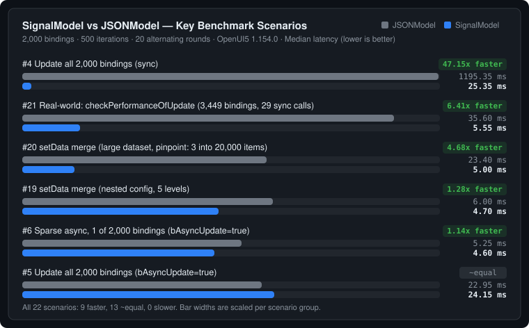

# SignalModel vs JSONModel - Performance Benchmark

Self-contained benchmark comparing SignalModel and JSONModel across all binding types.

## Quick Start

```bash
npm run start:bench                                        # browser -- opens benchmark page
npm run bench                                              # CLI -- headless, streams to terminal
npm run bench -- --bindings 1000 --iterations 500 --rounds 10
npm run bench -- --bindings 2000 --json results.json       # save results as JSON
npm run bench:stable                                       # CLI -- several runs, ratios with confidence intervals
npm run bench:render                                       # regenerate the published chart and table
```

| File                                   | Role                                                                    |
| -------------------------------------- | ----------------------------------------------------------------------- |
| `index.html`                           | The benchmark: harness and all scenarios. Runs standalone in a browser. |
| `bench.spec.mjs`, `wdio-bench.conf.ts` | Drive the page in headless Chrome and print results (`npm run bench`).  |
| `bench-stats.mjs`                      | Comparison statistics, with a self-check (`node bench-stats.mjs`).      |
| `scripts/run-benchmark-stable.mjs`     | Repeats the run and merges the results (`npm run bench:stable`).        |
| `scripts/render-benchmark-results.mjs` | Renders the chart and results table from `docs/benchmark-results.json`. |

None of these files are part of the published library package.

### Multi-run stability analysis

`npm run bench:stable` runs the CLI benchmark several times and reports, per scenario, the speed-up ratio with a 95% confidence interval across runs. A single run cannot tell a real difference from run-to-run variation; this can.

```bash
npm run bench:stable                                       # 4 runs at 2000 bindings (defaults)
npm run bench:stable -- --runs 6 --bindings 1000
npm run bench:stable -- --runs 4 --json stability.json     # save merged results as JSON
```

| Flag             | Default | Description                                         |
| ---------------- | ------- | --------------------------------------------------- |
| `--runs N`       | `4`     | Number of benchmark runs (published results use 10) |
| `--bindings N`   | `2000`  | Number of UI5 property bindings                     |
| `--iterations N` | `500`   | Calls per operation in scenarios 1-2                |
| `--rounds N`     | `20`    | Measured rounds per run                             |
| `--json <file>`  | --      | Save merged results as JSON                         |

**How runs are combined:**

- Each run contributes one paired ratio per scenario: its JSONModel median divided by its SignalModel median (above 1 means SignalModel is faster). Both models share that run's machine state, so the ratio cancels differences between runs.
- The result is the geometric mean of those ratios with a 95% confidence interval (Student's t on the log ratios, over runs).
- **faster** / **slower**: the whole interval lies on one side of 1. If the effect is below 10% it is labelled **marginally** faster/slower.
- **no clear difference**: the interval includes 1. This means the runs could not separate the models, not that they are equivalent; the interval shows how large a difference is still compatible with the data.
- With 22 intervals at 95%, about one is expected to miss the true value by chance. More runs narrow the intervals.

### Browser mode

`npm run start:bench` starts the dev server and opens the benchmark page. Select binding count, iterations, and rounds from the dropdowns, then click "Run Benchmark".

### CLI mode

`npm run bench` runs all scenarios in headless Chrome via WDIO and streams results to the terminal as each scenario completes. No browser window opens.

| Flag             | Default | Description                                                         |
| ---------------- | ------- | ------------------------------------------------------------------- |
| `--bindings N`   | `500`   | Number of UI5 property bindings                                     |
| `--iterations N` | `500`   | Calls per operation in scenarios 1-2                                |
| `--rounds N`     | `20`    | Measured rounds (alternating A-B); N rounds = N/2 samples per model |
| `--json <file>`  | --      | Save results as JSON                                                |

The CLI reuses the same benchmark page and WDIO infrastructure as the QUnit tests -- no additional dependencies. The benchmark HTML page accepts URL parameters (`?n=&iterations=&rounds=&autorun`) and exposes a `window.__bench` global that the WDIO spec polls for streaming results.

JSON output format:

```json
{
  "timestamp": "2026-04-03T...",
  "config": { "bindings": 1000, "iterations": 500, "rounds": 10 },
  "environment": { "userAgent": "Mozilla/5.0 ... HeadlessChrome/158.0.0.0 ...", "ui5": "1.154.0" },
  "floorMs": 0.0092,
  "results": [
    {
      "name": "Update all 1000 bindings (sync)",
      "category": "Property (sap.m.Text)",
      "json": {
        "n": 5,
        "median": 204.6,
        "mean": 210.3,
        "stddev": 12.1,
        "min": 195.0,
        "max": 240.1,
        "p5": 195.0,
        "p95": 240.1,
        "samples": [204.6, 195.0, 240.1, 201.2, 210.6]
      },
      "signal": { "...": "same shape" }
    }
  ]
}
```

All times are milliseconds per operation. `floorMs` is the harness floor (see [What Is Timed](#what-is-timed)).

`npm run bench:stable -- --json <file>` writes a merged file instead: per scenario the full per-run statistics (`runs`), the per-run ratios (`ratios`), each model's median across runs (`jsonMedian`, `signalMedian`) and the result (`ratio`, `low`, `high`, `verdict`), plus `environment` extended with CPU, memory, OS and Node.js version. [docs/benchmark-results.json](../../../../docs/benchmark-results.json) is such a file.

## What It Tests

22 scenarios across all binding types, model operations, and merge strategies:

| #   | Binding Type                | Scenario                             | What It Measures                                                |
| --- | --------------------------- | ------------------------------------ | --------------------------------------------------------------- |
| 1   | Model API                   | setProperty throughput (no bindings) | Raw per-call overhead of model layer                            |
| 2   | Model API                   | getProperty throughput               | Read performance                                                |
| 3   | Property (`sap.m.Text`)     | Single-path update, N bindings       | O(1) vs O(N) notification, the key benchmark                    |
| 4   | Property (`sap.m.Text`)     | Update all N bindings (sync)         | O(N) vs O(N^2) cumulative cost                                  |
| 5   | Property (`sap.m.Text`)     | Update all N bindings (bAsyncUpdate) | JSONModel `bAsyncUpdate=true` vs signals                        |
| 6   | Property (`sap.m.Text`)     | Sparse update, 1 of N (bAsyncUpdate) | Single path change with N bindings, async mode                  |
| 7   | List (`sap.m.List`)         | List binding replace                 | Array replacement with `StandardListItem` template              |
| 8   | List (`sap.m.Table`)        | Table binding replace                | Row replacement with 3 `ColumnListItem` cells                   |
| 9   | List (`sap.ui.table.Table`) | Grid table binding replace           | Virtualized row replacement, 3 columns, no row cap              |
| 10  | Tree (`sap.m.Tree`)         | Tree binding replace                 | Hierarchical data replacement with `StandardTreeItem`           |
| 11  | Expression (`sap.m.Text`)   | Expression binding                   | Composite `{= ${/path1} + ${/path2}}` re-evaluation             |
| 12  | Computed (`sap.m.Text`)     | Computed signals                     | `createComputed` propagation vs. a JSONModel formatter          |
| 13  | Computed (`sap.m.Text`)     | Computed (redefined)                 | Propagation after `removeComputed` + `createComputed`           |
| 14  | Computed (`sap.m.Text`)     | Computed sub-path                    | Sub-path of a computed object vs. a JSONModel formatter         |
| 15  | Computed (`sap.m.Text`)     | Computed redefine + sub-path         | Propagation to sub-path bindings after a redefinition           |
| 16  | Property (`sap.m.Text`)     | setData replace                      | Full data replacement propagation                               |
| 17  | Property (`sap.m.Text`)     | setData merge (shallow)              | Merge 5 items into N, small payload into large data             |
| 18  | Property (`sap.m.Text`)     | setData merge (deep)                 | Merge all N items, full payload, worst case for merge           |
| 19  | Property (`sap.m.Text`)     | setData merge (nested config)        | Merge 3 deep leaf paths into a 5-level config tree              |
| 20  | Property (`sap.m.Text`)     | setData merge (large, pinpoint)      | Merge 3 items into 10x N, tests O(k) vs O(n) merge              |
| 21  | Property (`sap.m.Text`)     | Warning threshold: 29 sync calls     | 3,449 bindings, 29 sync calls, just past UI5's 100k warning     |
| 22  | Property (`sap.m.Text`)     | Deep-path setProperty (no computeds) | 4-segment path `_findComputedAncestor` overhead, zero computeds |

### Merge Scenario Design

The merge scenarios (17-20) test different payload shapes that exercise the `setData(data, true)` code path with varying data-to-payload ratios:

- **Shallow (17)**: Small flat payload into a large flat array. Both models pay the `deepExtend`/in-place merge cost, but binding notification cost dominates because all N bindings exist. Tests the common "update a few fields in a form" pattern.
- **Deep (18)**: Payload covers every item. Worst case for merge: no savings from targeted invalidation. Both models must process all N items.
- **Nested config (19)**: Realistic deeply nested configuration object (5 levels: `app.features.notifications.push`). The merge payload touches only 3 leaf paths. Tests recursive merge depth traversal.
- **Large dataset, pinpoint (20)**: The key merge benchmark. Creates 10x N items (e.g., 10,000 for N=1000) with complex objects (7 properties, nested `metadata`), then merges only 3 items. JSONModel's `deepExtend` must deep-clone all 10,000 objects. SignalModel's in-place merge walks only the 3 payload items. Isolates the O(n) vs O(k) architectural difference.

## How It Works

### Bootstrap

The page loads UI5 via the standard bootstrap script served by `ui5 serve`. `ui5-tooling-transpile-middleware` transpiles TypeScript on-the-fly and `ui5-tooling-modules-middleware` resolves npm dependencies (`signal-polyfill`) into UI5-compatible modules.

### Module Loading

When "Run Benchmark" is clicked, `sap.ui.require` loads:

- `sap/ui/model/json/JSONModel` (from the OpenUI5 framework)
- `ui5/model/signal/SignalModel` (from the library, transpiled from TypeScript)
- Control classes: `sap/m/Text`, `sap/m/List`, `sap/m/Table`, `sap/m/Tree`, `sap/ui/table/Table`, and their list items/columns
- `sap/ui/core/Rendering` (to run the render pass inside the timed region, see [What Is Timed](#what-is-timed)) and `sap/ui/VersionInfo` (recorded in the results)

### Execution

Each sample:

1. Creates a fresh model with deep-copied data (`JSON.parse(JSON.stringify(...))`)
2. Creates real UI5 controls with declarative bindings, placed in a hidden `display:none` container
3. Runs 3 warmup rounds
4. Times the operation (see below)
5. Destroys all controls and the model

The `runAlternating` function interleaves JSON and Signal samples (JSON-Signal, Signal-JSON, JSON-Signal...) to cancel out GC pauses, thermal throttling, and JIT compilation bias. `--rounds 20` therefore yields 10 samples per model.

### What Is Timed

The clock runs from the model call (`setProperty` / `setData`) until **the bound control holds the new value and its DOM has been re-rendered**. Every sample checks the value on the control itself (`getText()`, list items, table cells); if the update never arrives the run fails instead of timing a no-op.

- **Repetition.** The operation is repeated until a sample spans at least 20 ms, and the mean time per operation is reported. This keeps every sample far above the 0.1 ms resolution of `performance.now()`, so microsecond-scale results are meaningful.
- **No timers in the timed region.** Waiting uses microtask hops (SignalModel's default `queueMicrotask` flush), then `MessageChannel` tasks. A `setTimeout(0)` wait would add the browser's nested-timer clamp (4 ms in Chrome, up to ~15 ms on Windows) to every sample and bury the model cost underneath it. Only the `bAsyncUpdate` scenarios (5, 6) include a timer: the one both models schedule themselves.
- **Rendering included, its timer is not.** UI5 schedules rendering with `setTimeout(0)`. The benchmark suspends that timer and runs the same render pass synchronously (`Rendering.renderPendingUIUpdates`) once the update has propagated, so samples contain the rendering work but not the timer wait. `sap/ui/core/Rendering` is a private UI5 module; a UI5 upgrade can break the benchmark (not the library), in which case it fails loudly instead of reporting wrong numbers.
- **Equivalent work.** Computed-signal scenarios (12-15) compare against a JSONModel formatter that derives the same value, and both models write the same path. JSONModel has no counterpart to redefining a computed, so in 13 and 15 its side is the same workload as in 12.
- **Harness floor.** Each run also times `control.setText()` plus the render pass with no model involved (`floorMs`). Every per-operation time includes about this much, so the smallest SignalModel times are mostly floor, and the ratios understate the difference in model cost alone.
- **Real item counts.** List, table, and tree scenarios raise the model size limit, which otherwise caps aggregation bindings at 100 entries. Note that 500 rows without growing is above what `sap.m.List` / `sap.m.Table` are documented for (about 200).

> [!IMPORTANT]
> **What the numbers do and do not say.** Each number is the time from the model write until UI5 has re-rendered the affected controls' DOM. Not included: browser layout and paint (the controls sit in a hidden container), the `setTimeout(0)` UI5 normally waits before rendering, and model or binding creation. In a visible application every update additionally pays for layout and paint, which is the same for both models, so the ratios you observe on screen will be smaller than the ones below. The absolute savings (JSONModel time minus SignalModel time) carry over.

### Statistics

Per model and run: median, mean, Bessel-corrected standard deviation, min, max, P5, P95 over the raw samples. No outliers are removed, and the samples are kept in the JSON output so results can be re-analysed. The median is the per-run metric.

A **single run** (`npm run bench`, browser page) reports faster/slower only if the difference exceeds 3 standard errors and 10%; otherwise `~equal`, meaning no difference was detected. Treat a single run as an indication.

**Published results** come from `npm run bench:stable`, which reports the ratio with a 95% confidence interval across runs (see [above](#multi-run-stability-analysis)).

Scenarios run in a fixed order and samples alternate only within a scenario. Ratios within a scenario are therefore reliable; absolute times of different scenarios were measured minutes apart and should not be compared closely.

## Results

> [!IMPORTANT]
> These numbers are from a single desktop machine (Windows "Balanced" power plan, library served unminified from the dev server). **Results vary** across hardware, OS, and browser version. Treat them as directional guidance, not guarantees, and run `npm run bench:stable` on your own machine.

Everything between the markers below is generated from [docs/benchmark-results.json](../../../../docs/benchmark-results.json):

```bash
npm run bench:stable -- --runs 10 --json docs/benchmark-results.json   # measure
npm run bench:render                                                   # regenerate chart and table
```

<!-- bench:results:start (generated by `npm run bench:render`; do not edit) -->

**Run:** 10 runs x 20 rounds (10 samples per model and run), 2,000 bindings, measured 2026-11-24.
**Environment:** OpenUI5 1.154.0, headless Chrome 158, Node.js 26.10.0, 12th Gen Intel(R) Core(TM) i7-12700K, 32 GB RAM, Windows_NT 10.0.26300.
**Harness floor:** 17.1 µs per operation (`setText` + render pass, no model), included in every time below.



<details>
<summary>All 22 scenarios (time per operation: model write to re-rendered DOM)</summary>

| #   | Binding Type              | Scenario                                        | JSONModel | SignalModel | SignalModel vs JSONModel (95% CI)     |
| --- | ------------------------- | ----------------------------------------------- | --------- | ----------- | ------------------------------------- |
| 1   | Model API                 | setProperty throughput (no bindings)            | 0.200 ms  | 0.134 ms    | **1.53x faster (1.48x-1.59x)**        |
| 2   | Model API                 | getProperty throughput                          | 0.151 ms  | 0.102 ms    | **1.48x faster (1.43x-1.53x)**        |
| 3   | Property (sap.m.Text)     | Single-path update, 2000 bindings               | 1.22 ms   | 22.9 µs     | **52x faster (48x-55x)**              |
| 4   | Property (sap.m.Text)     | Update all 2000 bindings (sync)                 | 1911 ms   | 38.08 ms    | **52x faster (47x-58x)**              |
| 5   | Property (sap.m.Text)     | Update all 2000 bindings (bAsyncUpdate)         | 34.45 ms  | 35.55 ms    | no clear difference (0.89x-1.02x)     |
| 6   | Property (sap.m.Text)     | Sparse update, 1 of 2000 (bAsyncUpdate)         | 1.17 ms   | 39.9 µs     | **30x faster (27x-33x)**              |
| 7   | List (sap.m.List)         | List binding replace, 500 items                 | 74.02 ms  | 75.98 ms    | no clear difference (0.92x-1.14x)     |
| 8   | List (sap.m.Table)        | Table binding replace, 500 rows                 | 21.77 ms  | 21.26 ms    | no clear difference (0.94x-1.18x)     |
| 9   | List (sap.ui.table.Table) | Grid table binding replace, 2000 rows           | 1.96 ms   | 1.99 ms     | no clear difference (0.98x-1.12x)     |
| 10  | Tree (sap.m.Tree)         | Tree binding replace, 200 nodes                 | 17.69 ms  | 18.83 ms    | no clear difference (0.90x-1.11x)     |
| 11  | Expression (sap.m.Text)   | Expression binding, 500 controls                | 0.573 ms  | 27.8 µs     | **19x faster (15x-23x)**              |
| 12  | Computed (sap.m.Text)     | Computed signals, 2000 computeds                | 0.947 ms  | 26.3 µs     | **36x faster (32x-41x)**              |
| 13  | Computed (sap.m.Text)     | Computed (redefined), 2000 computeds            | 0.998 ms  | 25.6 µs     | **37x faster (34x-39x)**              |
| 14  | Computed (sap.m.Text)     | Computed sub-path, 2000 computeds               | 1.09 ms   | 28.2 µs     | **41x faster (38x-46x)**              |
| 15  | Computed (sap.m.Text)     | Computed redefine + sub-path, 2000 computeds    | 1.12 ms   | 26.9 µs     | **40x faster (37x-44x)**              |
| 16  | Property (sap.m.Text)     | setData replace, 2000 bindings                  | 42.18 ms  | 44.27 ms    | marginally slower 1.05x (1.01x-1.09x) |
| 17  | Property (sap.m.Text)     | setData merge (shallow), 2000 bindings          | 2.58 ms   | 0.101 ms    | **25x faster (23x-27x)**              |
| 18  | Property (sap.m.Text)     | setData merge (deep), 2000 bindings             | 44.35 ms  | 41.37 ms    | **1.12x faster (1.03x-1.22x)**        |
| 19  | Property (sap.m.Text)     | setData merge (nested config), 2000 bindings    | 2.63 ms   | 25.7 µs     | **99x faster (92x-110x)**             |
| 20  | Property (sap.m.Text)     | setData merge (large, pinpoint), 20000 items    | 35.22 ms  | 60.1 µs     | **580x faster (520x-630x)**           |
| 21  | Property (sap.m.Text)     | Warning threshold: 29 sync calls, 3449 bindings | 56.60 ms  | 0.568 ms    | **94x faster (85x-100x)**             |
| 22  | Property (sap.m.Text)     | Deep-path setProperty (no computeds), 2000      | 1.43 ms   | 23.0 µs     | **56x faster (50x-62x)**              |

</details>

16 faster, 1 slower, 5 no clear difference. Times are each model's median across runs; the comparison is the geometric mean of the per-run ratios with its 95% confidence interval. Raw data including all samples: [docs/benchmark-results.json](../../../../docs/benchmark-results.json).

<!-- bench:results:end -->

### Observations

These notes interpret the generated results above (10 runs, 2,000 bindings). Ratios are quoted with their 95% confidence interval. Absolute times depend on machine state: an earlier 10-run measurement on the same machine was 20-35% faster across the board for both models, with the same ratios. Read the ratios, not the milliseconds.

**The pattern: O(bindings) vs O(changed paths).**

Every synchronous JSONModel write runs `checkUpdate` over all bindings of the model. With 2,000 bindings that is a fixed 0.6-1.4 ms per write no matter how little changed, and that fixed cost is what scenarios 3, 11-15 and 22 measure on the JSONModel side. SignalModel notifies only the bindings of the changed path and comes in at 23-28 µs, of which about 17 µs is the harness floor (`setText` plus the render pass). So those 19-56x ratios compare "floor + a pass over all bindings" with "floor + almost nothing"; they grow with the number of bindings on the model and shrink with the amount of rendering an update triggers.

**Where it matters in absolute terms:**

- "Update all 2000 bindings (sync)": 2,000 consecutive `setProperty` calls take ~1.9 s with JSONModel (2,000 x 2,000 = 4,000,000 binding checks, O(N²)) vs ~38 ms with SignalModel (O(N)): 52x faster (47x-58x). With `bAsyncUpdate`, JSONModel does the same work in ~34 ms (next section).
- "Warning threshold" (3,449 bindings, 29 synchronous calls, just past the 100,000 cumulative binding checks at which UI5 logs its `checkPerformanceOfUpdate` warning): ~57 ms vs ~0.57 ms, 94x faster (85x-100x). The binding count is borrowed from an ODataModel report in issue 2600 that saw ~200 ms per call; this synthetic JSONModel + `sap.m.Text` setup measures ~2 ms per call and does not reproduce that figure.
- "setData merge (large, pinpoint)": merging 3 items into 20,000 takes ~35 ms with JSONModel, whose `deepExtend` clones the whole array, vs ~60 µs for SignalModel's in-place merge that walks only the payload (O(n) vs O(k)): 580x faster (520x-630x).

In the other "faster" scenarios JSONModel is already at or below ~3 ms per update. The ratio is real, but the saving is at most ~3 ms per update.

**The `bAsyncUpdate` path:**

JSONModel's `setProperty` accepts a `bAsyncUpdate` parameter that batches `checkUpdate` calls into a single `setTimeout` pass, collapsing O(N²) to O(N). This is the mitigation the UI5 team recommends. SignalModel tracks dirty paths and syncs them in a single `setTimeout` as well. Both timings include that `setTimeout(0)` hop.

- Updating all 2,000 bindings this way: 34.5 ms vs 35.6 ms, no clear difference (0.89x-1.02x). The interval leans towards SignalModel being slower (geometric mean 0.96x, 6 of 10 runs) but cannot establish it; a slowdown of up to 11% is compatible with the data, and so is parity.
- A sparse update (1 of 2,000): 1.17 ms vs 40 µs, 30x faster (27x-33x), because SignalModel does not scan the unchanged bindings.

**Where SignalModel is slower or the models could not be separated:**

- `setData` replace is **marginally slower**: 1.05x (1.01x-1.09x), in 9 of 10 runs. This benchmark does not show where the extra time goes.
- Replacing a whole aggregation (list, table, grid table, tree) shows no clear difference. The intervals span roughly -10% to +18% around parity, so differences of that size in either direction cannot be ruled out.
- A deep merge covering all 2,000 items is 1.12x faster (1.03x-1.22x).

With 22 intervals at 95%, about one is expected to miss the true value by chance, so the two results whose intervals only just exclude 1 (`setData` replace, deep merge) are weaker evidence than the rest.

**Computed signals:**

Scenarios 12-15 compare a computed signal against a JSONModel formatter deriving the same value. All four SignalModel times are within about 10 µs of the harness floor. Because scenarios are not interleaved with each other, this benchmark cannot resolve differences of a few microseconds between them; it shows that redefining computeds and binding to sub-paths of computed objects stay in the same range as a plain computed, not that they cost exactly the same. The cost of the redefinition itself is not timed.

**Deep paths:**

"Deep-path setProperty (no computeds)" writes a 4-segment path with zero computed signals and lands in the same range as the single-path scenario (23.0 µs vs 22.9 µs), again within what the floor and run-to-run variation allow.

**Raw model API:**

Without any bindings, 500 `setProperty` calls take ~0.20 ms (JSONModel) vs ~0.13 ms (SignalModel), and 500 `getProperty` calls ~0.15 ms vs ~0.10 ms. Both are a fraction of a microsecond per call; the difference is irrelevant in practice.

**What is not measured:**

Browser layout and paint, the `setTimeout(0)` before UI5's render pass, model and binding creation, memory, ODataModel, and the minified library build.

**What SignalModel offers over JSONModel with `bAsyncUpdate`:**

1. **No opt-in needed.** Developers do not need to remember to pass `bAsyncUpdate=true`. UI5 logs a `checkPerformanceOfUpdate` warning when consecutive synchronous `setProperty` calls add up to more than 100,000 binding checks; with SignalModel that pattern costs a notification per changed path.

2. **Per-path notification in both modes.** JSONModel checks all bindings of the model: once per call when synchronous, once per batch with `bAsyncUpdate`. SignalModel notifies only the bindings of the changed paths in both modes. For a full batch that is the same amount of work; for a sparse update it is much less.

3. **Computed signals.** Model-layer derived values (`createComputed`) that update reactively. JSONModel has no equivalent; formatters are view-layer and do not participate in the model's dependency graph.

4. **In-place merge.** `setData(partial, true)` uses an O(k) in-place recursive merge instead of O(n) `deepExtend` clone. For large datasets with small merge payloads the cost no longer depends on the data size (~35 ms vs ~60 µs at 20k items).

> [!NOTE]
> **Native Signals outlook.** SignalModel currently uses [signal-polyfill](https://github.com/proposal-signals/signal-polyfill), a JavaScript implementation of the [TC39 Signals proposal](https://github.com/tc39/proposal-signals). When signals ship natively in browsers, the polyfill can be swapped for the native implementation with zero API changes. Native signals will be implemented in C++ by the browser engine, eliminating the JavaScript overhead of the polyfill's reactive graph traversal, watcher notification, and dependency tracking. The architectural advantages (O(1) notification, in-place merge) will remain, and the constant factors should improve across all signal-dependent scenarios.

## Background

- [openui5 issue 2600](https://github.com/UI5/openui5/issues/2600) - discusses the cost of `checkUpdate` iterating all bindings. Two things from that thread to keep in mind when reading this benchmark: the reported cases were ODataModel applications, and the UI5 maintainers' position is that most applications are not affected and can use `bAsyncUpdate` or avoid redundant `setProperty` calls where they are.
- [openui5 issue 4351](https://github.com/UI5/openui5/issues/4351) - related DOM accumulation problem in large apps
- SAP commit `cb6c7f7a` - added `checkPerformanceOfUpdate` warning at 100,000 cumulative binding checks
